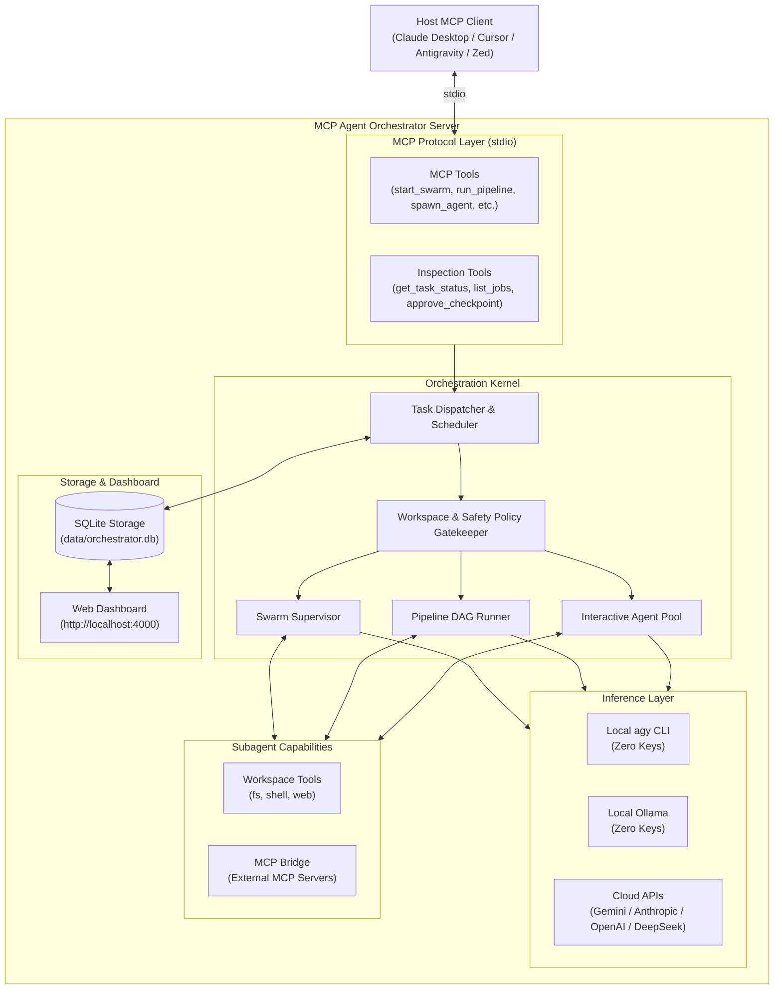

# ⚡ MCP Agent Orchestrator

[](https://www.typescriptlang.org/)
[](https://modelcontextprotocol.io/)
[](LICENSE)
[]()

An open, extensible **Model Context Protocol (MCP)** server that acts as a scalable, multi-modal **multi-agent coordination engine**.

It allows any MCP-compatible client (**Claude Desktop**, **Cursor**, **Antigravity**, **Zed**, **LibreChat**) to delegate complex multi-step programming and research goals to internal teams of specialized subagents — acting as a **context firewall** to conserve client token limits while preventing tool timeouts.

---

## 🌟 Key Features

* **🧠 Multi-Modal Orchestration**:
  1. **Cross-Session Agent Mesh (`invoke_session`, `send_session_message`, `check_inbox`)**: Spawn independent specialist subagents in isolated sessions with dedicated models, context boundaries, persistent SQLite inboxes, and bidirectional inter-session messaging.
  2. **Autonomous Swarm (`start_swarm`)**: Supervisor agent decomposes goals into subtasks, delegates to worker agents, and synthesizes final outputs.
  3. **Interactive Toolkit (`spawn_agent`, `send_agent_message`)**: Direct agent management primitives enabling host models to orchestrate custom loops.
  4. **Structured Pipelines (`run_pipeline`)**: Deterministic multi-stage DAG workflows passing typed artifacts with human-in-the-loop checkpoints (`approve_checkpoint`).
* **🔌 Flexible Inference (Zero API Keys or Cloud APIs)**:
  * **Zero-Key Local Setup**: Uses your authenticated local **Antigravity (`agy`)** CLI (accessing `gemini-3.8-flash-high`, `claude-sonnet-4-6`, etc.) or **Ollama**.
  * **Cloud API Setup**: Direct integrations for Google Gemini, Anthropic, OpenAI, or any OpenAI-compatible provider (DeepSeek, Groq, Together).
  * **Hybrid Setup**: Mix and match free local models for high-volume workers and cloud frontier models for critical reviews.
* **🛡️ Sandboxed Workspace Tools**:
  * Scoped filesystem tools (`fs_read`, `fs_write`, `fs_list`, `fs_delete`).
  * Controlled shell execution (`shell_exec`) with configurable safety modes (`autonomous`, `semi-autonomous`, `safe`).
  * Web search and HTTP fetch (`web_fetch`).
  * **MCP Gateway Bridge**: Subagents can dynamically call tools on third-party MCP servers (e.g. GitHub, PostgreSQL, Docker).
* **💾 State & Persistence**:
  * Embedded SQLite database (`data/orchestrator.db`) with WAL mode.
  * Persists task histories, agent thought transcripts, and generated artifacts across restarts.
* **🖥️ Live Web Dashboard**:
  * Runs on `http://localhost:4000` with Server-Sent Events (SSE).
  * Real-time progress tracker, live agent scratchpads, artifact previewer, and one-click checkpoint approval buttons.

---

## 🏗️ Architecture



---

## ⚡ Quick Start & CLI

### 1. Instant Run with `uvx` / `pip` (PyPI)
```bash
# Run directly via uvx (zero install) or install from PyPI
uvx agent-mesh-mcp doctor
pip install agent-mesh-mcp

# Start the MCP server over stdio
agent-mesh-mcp serve

# Launch the live Web Dashboard on http://localhost:4000
agent-mesh-mcp dashboard
```

### 2. Instant Run with `npx` (Node.js)
```bash
# Run the built-in system diagnostics & health check
npx agent-mesh-mcp doctor

# Generate a starter orchestrator.yaml in your current directory
npx agent-mesh-mcp init

# Start the MCP server over stdio
npx agent-mesh-mcp
```

### 3. Local Development & Build
```bash
git clone https://github.com/ShashankIIITN/agent-mesh-mcp.git
cd agent-mesh-mcp

# Install dependencies and compile TypeScript
npm install
npm run build

# Run all 14 unit and integration tests
npm test
```

---

## ⚙️ Configuration (`orchestrator.yaml`)

Create `orchestrator.yaml` in the project root (you can also reference [`orchestrator.example.yaml`](orchestrator.example.yaml)):

```yaml
version: "1.0"

server:
  port: 4000 # Web Dashboard port (http://localhost:4000)
  storage:
    type: "sqlite"
    connection_string: "./data/orchestrator.db"
  security:
    default_safety_mode: "semi-autonomous" # autonomous | semi-autonomous | safe
    allowed_workspaces:
      - "./"
      - "D:/"

# ─────────────────────────────────────────────────────────────────────────
# INFERENCE PROVIDERS
# Choose your setup: Local (Zero API Keys), Cloud API Keys, or Hybrid
# ─────────────────────────────────────────────────────────────────────────
inference:
  default_provider: "direct"
  # Cost & capability tiers for isolated child sessions
  tiers:
    fast:
      provider: "agy"
      model: "gemini-3.8-flash-low" # Ultra-fast, zero thinking-token overhead
    balanced:
      provider: "agy"
      model: "gemini-3.8-flash-high"
    heavy:
      provider: "agy_claude"
      model: "claude-sonnet-4-6"
  providers:

    # ── Option A: Local Antigravity CLI (Zero API Keys) ──
    # Auto-detected on Windows, macOS, and Linux!
    agy:
      type: "agy"
      model: "gemini-3.8-flash-high" # Or "claude-sonnet-4-6", "gemini-3.1-pro-high"

    # ── Option B: Local Ollama (Zero API Keys) ──
    ollama:
      type: "ollama"
      base_url: "http://localhost:11434"
      model: "llama3.3"

    # ── Option C: Cloud API Providers (Require API Keys) ──
    gemini:
      type: "gemini"
      model: "gemini-2.5-flash"
      api_key_env: "GEMINI_API_KEY"

    anthropic:
      type: "anthropic"
      model: "claude-3-7-sonnet-20250219"
      api_key_env: "ANTHROPIC_API_KEY"

    openai:
      type: "openai"
      model: "gpt-4o"
      api_key_env: "OPENAI_API_KEY"

    # ── Option D: Custom OpenAI-Compatible (DeepSeek, Groq, Together) ──
    deepseek:
      type: "openai-compatible"
      base_url: "https://api.deepseek.com"
      model: "deepseek-coder"
      api_key_env: "DEEPSEEK_API_KEY"

# ─────────────────────────────────────────────────────────────────────────
# DECLARATIVE AGENT PERSONAS
# Assign each agent whichever provider you prefer (local or cloud)
# ─────────────────────────────────────────────────────────────────────────
agents:
  researcher:
    role: "Research & Documentation Specialist"
    provider: "agy" # Using zero-key local model
    tools: ["web_fetch", "fs_read", "fs_list"]
    system_prompt: "You are an expert researcher. Synthesize concise and factual summaries."

  coder:
    role: "Senior Software Engineer"
    provider: "agy"
    tools: ["fs_read", "fs_write", "fs_list", "shell_exec"]
    system_prompt: "You are a senior engineer. Write clean, robust code and verify changes."

  reviewer:
    role: "Staff Security & QA Auditor"
    provider: "agy"
    tools: ["fs_read", "fs_list", "shell_exec"]
    system_prompt: "You are a staff reviewer focused on correctness, edge cases, and security."

# ─────────────────────────────────────────────────────────────────────────
# PRESET PIPELINES
# ─────────────────────────────────────────────────────────────────────────
pipelines:
  feature_implementation:
    stages:
      - name: "research"
        agent: "researcher"
        output_artifact: "research_notes.md"
        checkpoint: false
      - name: "code"
        agent: "coder"
        input_artifacts: ["research_notes.md"]
        output_artifact: "implementation.md"
        checkpoint: true # Pauses for human approval
      - name: "review"
        agent: "reviewer"
        input_artifacts: ["implementation.md"]
        checkpoint: false

# ─────────────────────────────────────────────────────────────────────────
# EXTERNAL MCP GATEWAYS (Optional)
# Subagents can call tools from these external servers
# ─────────────────────────────────────────────────────────────────────────
mcp_gateways:
  github:
    command: "npx"
    args: ["-y", "@modelcontextprotocol/server-github"]
    env:
      GITHUB_PERSONAL_ACCESS_TOKEN: "${GITHUB_TOKEN}"
```

---

## 🔌 Connecting to Your MCP Client

You can connect either via **`npx`** (instant, portable) or pointing directly to your local clone.

### 1. Antigravity (`agy`)
To register the orchestrator globally in your local Antigravity environment:

```powershell
# Using npx (portable):
agy mcp add agent-orchestrator npx -y mcp-agent-orchestrator

# OR using local build:
agy mcp add agent-orchestrator node "D:\my project\mcp-agent-orchestrator\dist\index.js" "D:\my project\mcp-agent-orchestrator\orchestrator.yaml"
```

Verify it is active:
```powershell
agy mcp list
```

---

### 2. Claude Desktop
Add to your `%APPDATA%\Claude\claude_desktop_config.json` (Windows) or `~/Library/Application Support/Claude/claude_desktop_config.json` (macOS):

```json
{
  "mcpServers": {
    "agent-orchestrator": {
      "command": "npx",
      "args": ["-y", "mcp-agent-orchestrator"]
    }
  }
}
```

*(Or replace `"command": "node"` and point to `"D:\\my project\\mcp-agent-orchestrator\\dist\\index.js"` for local development).*

---

### 3. Cursor
1. Open **Cursor Settings** $\rightarrow$ **Features** $\rightarrow$ **MCP Servers**.
2. Click **Add New MCP Server**:
   * **Name**: `agent-orchestrator`
   * **Type**: `command`
   * **Command**:
     ```bash
     npx -y mcp-agent-orchestrator
     ```
     *(Or `node "D:\my project\mcp-agent-orchestrator\dist\index.js"`)*

---

## 🛠️ MCP Tool Reference

### Cross-Session Agent Mesh Tools (v0.2.0)
| Tool | Mode | Parameters | Description |
| :--- | :--- | :--- | :--- |
| `invoke_session` | Session Mesh | `name?`, `role?`, `system_prompt?`, `agent_preset?`, `tier?` (`fast`/`balanced`/`heavy`), `model?`, `provider?`, `allowed_tools?`, `workspace_path?`, `safety_mode?`, `parent_session_id?`, `initial_message?`, `await_response?`, `max_iterations?` | Spawns an independent specialist session with its own isolated context window, model/cost tier, and recursive sub-session tools (`mesh_invoke_session`). |
| `invoke_sessions_parallel` | Session Mesh | `sessions[]`, `parent_session_id?`, `await_all?` | Fans out multiple tasks across $N$ isolated AI sessions concurrently, each with its own context window and custom model/tier (`fast`/`balanced`/`heavy`). Returns distilled outputs + Context Firewall savings. |
| `send_session_message` | Session Mesh | `target_session_id`, `content`, `sender_session_id?`, `await_response?`, `message_type?` | Sends a task or follow-up instruction to a specific session. Can await response or dispatch asynchronously to the inbox queue. |
| `check_inbox` | Session Mesh | `session_id?`, `unread_only?`, `mark_as_read?` | Checks incoming messages, deliverables, or peer notifications sent to the caller's session inbox. |
| `wait_for_inbox` | Session Mesh | `session_id?`, `timeout_ms?`, `mark_as_read?` | Event-driven reactive wait for background child sessions to deliver results to the inbox (zero busy-polling). |
| `list_sessions` | Session Mesh | `filter?` (`all`/`active`/`my_children`), `parent_session_id?` | Inspects all sessions, active states, model/tier assignments, hierarchy depth, and aggregate `mesh_stats` (Context Firewall token savings & effective context multiplier). |
| `get_session_transcript` | Session Mesh | `session_id` | Retrieves complete conversation logs, tool invocations, inbox events, and isolated context stats for a session. |
| `pause_session` | Session Mesh | `session_id` | Pauses execution of an active session. |
| `resume_session` | Session Mesh | `session_id` | Resumes execution of a paused session and drains pending message queues. |
| `terminate_session` | Session Mesh | `session_id` | Gracefully terminates a session and closes its communication channel. |
| `broadcast_session_message` | Session Mesh | `content`, `sender_session_id?`, `parent_session_id?` | Broadcasts an announcement or directive to multiple child sessions simultaneously. |
| `kill_all_sessions` | Session Mesh | `parent_session_id?` | Emergency stop terminating all active child sessions. |

### Swarm, Pipeline & Interactive Tools
| Tool | Mode | Parameters | Description |
| :--- | :--- | :--- | :--- |
| `start_swarm` | Swarm | `goal`, `context?`, `workspace_path?`, `safety_mode?` | Dispatches an autonomous background swarm. Decomposes the goal, runs subagents, and synthesizes output. Returns immediately with a `job_id`. |
| `run_pipeline` | Pipeline | `pipeline_name`, `inputs?`, `workspace_path?`, `safety_mode?` | Runs a declarative DAG pipeline by name with artifact chaining between stages. |
| `spawn_agent` | Interactive | `name`, `role`, `system_prompt`, `provider?`, `allowed_tools?` | Dynamically creates an isolated subagent instance in the agent pool. |
| `send_agent_message` | Interactive | `agent_id`, `message`, `workspace_path?`, `safety_mode?` | Sends a prompt to a spawned subagent, executing its internal ReAct tool-use loop. |
| `list_agents` | Interactive | *(none)* | Returns all currently active interactive agent instances and stats. |
| `terminate_agent` | Interactive | `agent_id` | Terminates and cleans up an interactive subagent. |
| `get_task_status` | Status | `job_id`, `include_logs?` | Inspects live progress (0–100%), current step, final output, logs, and pending approvals. |
| `list_jobs` | Status | `limit?` | Lists recorded jobs across all modes with timestamps and statuses. |
| `approve_checkpoint` | Checkpoint | `job_id`, `checkpoint_id`, `decision` (`approve`/`reject`), `feedback?` | Resolves a paused pipeline checkpoint waiting for human review. |
| `get_config` | System | *(none)* | Returns the active configuration (sanitized with API keys redacted). |

---

## 🤖 Autonomous Agent Prompt (`GEMINI.md` / `CLAUDE.md`)

To let **Gemini** (Antigravity / Gemini CLI) or **Claude** (Claude Code / Claude Desktop) use the **Multi-Context & Model-Tiered Session Mesh autonomously** without manual prompting, copy [`GEMINI.md`](GEMINI.md) into `~/.gemini/GEMINI.md` or [`CLAUDE.md`](CLAUDE.md) into `~/.claude/CLAUDE.md` (or your project root):

```markdown
# 🌐 Autonomous Multi-Context & Model-Tiered Session Mesh Protocol (`agent-orchestrator`)

You are connected to the `agent-orchestrator` MCP server, which gives you the ability to spin up
**isolated AI sessions with separate context windows** and **custom model/cost tiers** (`fast`, `balanced`, `heavy`).

Use this Session Mesh **autonomously and proactively** without waiting for the user to ask you to spawn sessions.

## 🧠 Core Operating Principles

### 1. The Context Firewall Rule (Multiply Your Context Window)
- **Protect your primary context window**: Do NOT dump large file explorations (>3 files), noisy test/build logs, or bulk codebase scans into your main context window.
- **Offload to isolated sub-sessions**: Spin up a child session (`invoke_session` or `invoke_sessions_parallel`). Each spawned session runs in its **own fresh context window**, performs up to 20 tool-use iterations internally, and returns only a **distilled, high-signal summary** to your main session.
- **Reuse warm child contexts**: When you have follow-up questions about code a child session already read, call `send_session_message` with `target_session_id`—it resumes the child's persistent conversation context (`--conversation`) with prompt caching instead of re-reading files from scratch.

### 2. Cost & Capability Model Tiering (`tier: "fast" | "balanced" | "heavy"`)
Always select the lowest tier capable of solving the subtask with high quality:

| Tier | Default Model | Cost / Speed | When to Use Autonomously |
| :--- | :--- | :--- | :--- |
| **`fast`** | `gemini-3.8-flash-low` (`gemini-3.8-flash-lite`) | Lowest cost, 0 thinking overhead | Codebase scouting, file discovery, log/diff summarization, doc extraction, boilerplate & unit test drafting. |
| **`balanced`** | `gemini-3.8-flash-high` | Moderate cost, fast reasoning | Standard feature implementation, API routes, DB schemas (`prisma-db-architect`), automated QA (`qa-tester`), general code review. |
| **`heavy`** | `claude-sonnet-4-6` / `Gemini 4 Argon (High)` | Frontier reasoning (auto-fallback on quota limits) | Complex system architecture, security audits, subtle bug root-cause analysis, Clean Architecture backend (`ts-backend-coder`), UI/UX (`frontend-designer`). |

### 3. Parallel Context Multiplication (`invoke_sessions_parallel`)
Whenever a task can be decomposed into **2 or more independent tracks** (e.g., scouting two subsystems, auditing security + performance + tests, or implementing backend + frontend), call `invoke_sessions_parallel` to run N isolated context windows concurrently.

### 4. Recursive Sub-Sessions (Child Spawns Grandchild)
Every spawned session automatically receives `mesh_invoke_session`, `mesh_send_message`, `mesh_check_inbox`, and `mesh_wait_for_inbox` (up to `MAX_SESSION_DEPTH = 3`). A `heavy` architect session can autonomously spawn `fast` scout sub-sessions to gather file details without polluting the architect's context window.
```

---

## 💡 Example Prompts to Try in Your AI Client

Once connected, you can interact with the orchestrator naturally:

### 1. Cross-Session Specialist Delegation (Mesh Mode)
> *"Use `invoke_session` to spawn a 'SecurityAuditor' using model `claude-sonnet-4-6` and task it with auditing `src/server.ts`. Run it in the background."*
>
> *"Check our inbox with `check_inbox` to see what the SecurityAuditor reported."*
>
> *"Send a follow-up to the auditor with `send_session_message` asking for remediation diffs."*
>
> *"Broadcast an announcement to all active subagents using `broadcast_session_message`."*

### 2. Autonomous Swarm Mode
> *"Use `start_swarm` to research best practices for caching and write a benchmark test in our workspace."*

### 3. Structured Pipeline Mode
> *"Run the `feature_implementation` pipeline using `run_pipeline` with input `topic: RateLimitingMiddleware`."*

### 4. Human-in-the-Loop Checkpoint
> *"Check job status using `get_task_status`. If there is a pending checkpoint, approve it using `approve_checkpoint`."*

---

## 🖥️ Live Web Dashboard

Whenever the orchestrator runs, the embedded web dashboard is available at:

👉 **[http://localhost:4000](http://localhost:4000)**

* **Live Task Monitoring**: Real-time progress percentage, active step descriptions, and status badges.
* **Thought Transcripts**: Live streaming of agent reasoning scratchpads and tool results via Server-Sent Events (SSE).
* **Interactive Approvals**: Visual banner with **Approve** and **Reject** buttons and feedback input for human checkpoints.
* **Artifact Viewer**: Preview generated Markdown and code outputs directly in the browser.

---

## 🛡️ Safety Modes & Sandboxing

The orchestrator enforces 3 security tiers configured in `orchestrator.yaml` or per-request:

| Mode | Filesystem Read | Filesystem Write | Shell Execution | Human Checkpoints |
| :--- | :---: | :---: | :---: | :---: |
| **`autonomous`** | ✅ Allowed | ✅ Allowed | ✅ Allowed | Automated |
| **`semi-autonomous`** *(Default)* | ✅ Allowed | ✅ Allowed | ⚠️ Logged & Controlled | Interactive |
| **`safe`** | ✅ Allowed | ❌ Blocked | ❌ Blocked | Read-only |

All file operations are strictly scoped within `security.allowed_workspaces`.

---

## 🖥️ Platform Support

Runs on **Windows, macOS, and Linux** (Node.js ≥ 20).

| | Windows | macOS | Linux |
| :--- | :--- | :--- | :--- |
| `agy` auto-discovery | `%LOCALAPPDATA%\agy\bin\agy.exe`, `PATH` | `PATH`, `/opt/homebrew/bin`, `/usr/local/bin`, `~/.local/bin` | `PATH`, `/usr/local/bin`, `~/.local/bin`, `/snap/bin` |
| Shell for `shell_exec` | `cmd.exe` | `/bin/sh` | `/bin/sh` |
| Home shortcut `~` in config | ✅ | ✅ | ✅ |

* Override the `agy` location with `binary_path` in a provider or the `AGY_BIN_PATH` environment variable.
* `allowed_workspaces` accepts `~` and absolute paths. Windows drive roots such as `D:/` are ignored on macOS/Linux, so one config file works everywhere.
* Local build on macOS/Linux:
  ```bash
  agy mcp add agent-orchestrator node "$PWD/dist/index.js" "$PWD/orchestrator.yaml"
  ```

---

## 📜 License

MIT License. Free to use, modify, and distribute.
